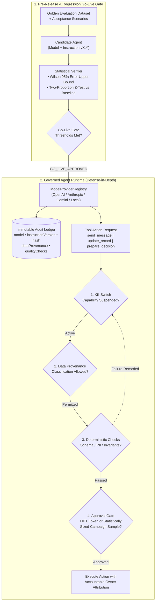

<div align="center">

# 🛡️ Agent Governance & Statistical Evaluation Runtime

**Production-grade evaluation gates, applied statistics (sample sizing & Wilson confidence bounds), deterministic runtime safeguards, approval workflows, data provenance observability, and automatic kill switches for tool-using, multi-step AI agents.**

[](src/runtime.mjs)
[](python/governance_stats.py)
[](tests/governance.test.mjs)
[](docs/ADR-0001-governed-agent-runtime.md)

[**🌐 Live Interactive Portfolio & Simulator →**](https://myalexverse.github.io)

</div>

---

## 🎯 Overview

When AI agents transition from passive chat interfaces to **taking real actions**—sending external communications (`send_message`), mutating records (`update_record`), and preparing operational decisions (`prepare_decision`)—safety and quality must be enforced **deterministically in code**, not merely requested in prompts.

This repository implements a **provider-independent Agent Governance & Evaluation Runtime** (in both **JavaScript/TypeScript ESM** and **Python**) that converts written governance rules, acceptance scenarios, and statistical quality thresholds into executable gates:

1. **📊 Applied Statistics for Evaluation & Campaign Review (`src/statistics.mjs` & `python/governance_stats.py`):**
   - **Finite-Population Review Sample Sizing:** Computes statistically required review sample sizes using Cochran's formula with finite-population correction before releasing high-volume campaigns.
   - **Wilson Score Confidence Bounds (`90% / 95% / 99%`):** Estimates true error-rate upper bounds from finite review samples so small sample sizes never mask quality risk.
   - **Two-Proportion Z-Test Regression Detection:** Re-evaluates agent capabilities after every model weight or instruction version change and flags statistically significant degradations.
2. **🔒 Governed Agent Runtime & Kill Switches (`src/runtime.mjs`):**
   - **Accountable Ownership:** Every registered capability requires an explicit accountable owner and action taxonomy (`send_message`, `update_record`, `prepare_decision`).
   - **Data Provenance & Classification Restrictions:** Enforces allowed data classifications (`public`, `internal`, `client_approved`, `restricted_pii`) before tool execution.
   - **Deterministic Pre-Execution Checks:** Code-level validators (PII/SSN leak guards, recipient domain checks, record ID invariants) execute prior to any irreversible side effect.
   - **Single-Action & Campaign-Level Approval Workflows:** Enforces human-in-the-loop sign-off for irreversible/external actions and statistical sample approval for batch campaigns.
   - **Automatic Quality-Based Suspension (Kill Switch):** Continuously tracks rolling outcomes and automatically suspends a capability when the 95% Wilson upper error bound exceeds policy thresholds.
3. **🔌 Model Provider Abstraction & Observability Ledger:**
   - Decouples agent workflows from any single vendor (`anthropic`, `openai`, `gemini`, `local`) via `ModelProviderRegistry`.
   - Records every model invocation with `callId`, `provider`, `model`, `instructionVersion`, SHA-256 `instructionHash`, `dataProvenance`, `latencyMs`, and deterministic output quality checks.
4. **🚦 Pre-Release Go-Live Gate (`src/evaluation-gate.mjs`):**
   - Runs golden datasets against candidate model/instruction versions, evaluates task pass rate, deterministic safety rate, 95% error upper bound, and regression vs. baseline, returning a deterministic `GO_LIVE_APPROVED` or `HOLD_RELEASE` decision.

---

## 🏗️ Runtime Governance Architecture



---

## 📐 Applied Statistics in Code

### 1. Statistically Sized Campaign Review Samples
Before approving a high-volume campaign of $N$ actions, the runtime computes the minimum required review sample size $n$ for confidence level $Z$, expected error rate $p$, and margin of error $e$:

$$n_0 = \frac{Z^2 \cdot p(1 - p)}{e^2}, \qquad n = \left\lceil \frac{n_0}{1 + \frac{n_0 - 1}{N}} \right\rceil$$

### 2. Wilson Score 95% Error Upper Bound Gating
Rather than trusting raw point estimates ($\hat{p} = k / n$), release gates and automatic suspension triggers evaluate the upper bound of the Wilson interval:

$$U_{\text{95\%}} = \frac{\hat{p} + \frac{z^2}{2n} + z\sqrt{\frac{\hat{p}(1-\hat{p})}{n} + \frac{z^2}{4n^2}}}{1 + \frac{z^2}{n}}$$

---

## 🧪 Running the Verification Suites (Node.js + Python)

Zero external dependencies are required—both suites run with the standard library:

```bash
# Run both Node.js ESM governance tests and Python statistical unit tests
npm test
```

Individual suites:

```bash
# Node.js / TypeScript Runtime & Go-Live Gate Tests
node --test tests/governance.test.mjs

# Python Applied Statistics & Confidence Bound Tests
python3 -m unittest discover -s python -p 'test_*.py'
```

---

## 📄 Design Notes & Architecture Decision Records

- [**ADR-0001: Governed Multi-Step Agent Runtime, Statistical Release Gates & Kill Switches**](docs/ADR-0001-governed-agent-runtime.md)

---

## 👨‍💻 Author

**Abel Alejandro Tovar** — *Senior Software & AI Systems Engineer*
- 🌐 **Portfolio:** [myalexverse.github.io](https://myalexverse.github.io)
- 💼 **LinkedIn:** [Abel Alejandro Tovar Amezola](https://www.linkedin.com/in/abel-alejandro-tovar-amezola-scendlabs)
- ✉️ **Contact:** [myalexverse@gmail.com](mailto:myalexverse@gmail.com)
